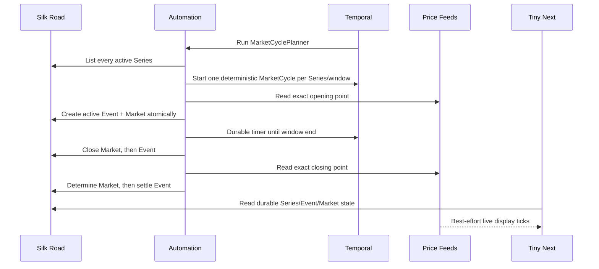

# Silk Road market lifecycle review

This review is pinned to
[`tiny-xyz/silk-road@cc19199`](https://github.com/tiny-xyz/silk-road/tree/cc19199591556e20c9a43f67552c45ea09e49e7b),
branch `keshav/temporal-market-lifecycle`, inspected on 2026-09-04. The sibling checkout at
`../silk-road` is reference-only; Tiny Next must consume public contracts, never backend source.

## Executive summary

The branch adds a working, automated lifecycle for one recurring market type: BTC UP/DOWN over a
whole-second UTC window. It is an orchestration and observability slice, not a trading stack.

An active Silk Road Series is the declaration. Automation discovers it, asks Price Feeds for an
exact opening price, atomically creates an active Event and Market in Silk Road, waits durably in
Temporal, closes both, reads the exact ending price, determines YES or NO, and settles the Event.
Every mutation has a deterministic operation key, and the Market stores the evidence needed to
audit the result.

## What the branch adds

| Area | Added behavior | Frontend consequence |
| --- | --- | --- |
| Automation | Temporal client, worker, planner Schedule, planner/cycle workflows, activities, retry classification, readiness and drain | Markets can appear and advance without an operator driving each transition |
| Lifecycle policy | Active `btc` + `updown` Series, positive whole-second Go duration, UTC buckets, exact comparison, deterministic IDs and copy | Tiny Next can explain a stable and auditable four-step lifecycle |
| Silk Road adapter | Cursor-complete public Series discovery plus idempotent Connect mutations | Silk Road remains the durable market source of truth |
| Price Feeds adapter | Exact point reads for opening and closing settlement evidence | Settlement must never use the live browser stream |
| Market UI | A standalone Vite observatory with Series selection, current window, evidence, timeline and history | Useful content reference, but not code or styling to port into Tiny Next |
| Local topology | Temporal, Automation and Market UI in Compose; browser CORS for Silk Road and Price Feeds | The complete path is runnable locally |
| Proof | Unit tests plus an isolated full-stack lifecycle harness with a fake Pyth provider | Restart, retry, exactness, pagination and per-window uniqueness are exercised |

Compared with `origin/main`, the branch is about 14,000 inserted lines across Automation, the new
Market UI, full-stack tests, Compose, docs and Price Feeds browser-origin configuration. It does not
change the Silk Road market service itself; it consumes the public reads and admin mutations that
already exist there.

## Repository ownership

| Component | Owns | Does not own |
| --- | --- | --- |
| `services/silkroad` | Categories, tags, Series, Events, Markets, operation receipts, market PostgreSQL schema | Price observations, Temporal history, exchange state |
| `services/pricefeeds` | Price assets, catalog, ticks, immutable pricing facts, feeds database, Valkey fan-out | Market outcomes or settlement decisions |
| `services/automation` | Stateless lifecycle policy and Temporal workflows | Any database or local durable state |
| Temporal | Schedule, workflow history, durable timers and retries | Market truth |
| `services/market-ui` | Read-only browser display state | Domain state or mutations |
| `services/point-guard` | Future sports-data ownership | No implemented domain behavior yet |
| `platform` / `protobuf` | Shared runtime mechanics / versioned process contracts | Service-domain policy |

## Exact lifecycle rules

- Only active Series with normalized `assetType=btc`, `marketType=updown`, and a positive
  whole-second `frequency` are eligible. Unsupported rows are skipped independently.
- Window boundaries are UTC frequency buckets. Workflow ID is
  `market-cycle:<series-id>:<window-start-unix>`; duplicate planner runs cannot create a second
  lifecycle for that window.
- Opening price must be available before the window ends. Otherwise no Market is created.
- The Market and Event become closed at the window end before resolution is attempted.
- Closing price greater than or equal to opening resolves YES/UP; lower resolves NO/DOWN.
- A missing closing point leaves an honest closed, unresolved Market while Temporal retries the
  same historical instant.
- Market metadata carries exact mantissa/exponent evidence and microsecond provider timestamps as
  strings where JSON precision would otherwise be unsafe.

## Explicitly not included

- No CLOB deployment, order admission, order book, quotes, trades, positions or fills.
- No probability history. Price Feeds history is the underlying BTC spot price, not a market price.
- No authentication or authorization on current Silk Road routes.
- No Series update API, so the branch cannot pause or retire a Series from its UI.
- No automation-job table or public workflow-status API; the workflow ID is only a correlation key.
- No sports lifecycle. Point Guard is still a documented target with a `Hello, World!` command.
- No reliable browser stream: current SSE has no snapshot, sequence, replay or acknowledgement.

## Review evidence

`go test ./services/automation/...` and the Market UI `make check` (typecheck, formatting and 12
tests) pass. The Docker full-stack test was inspected but not run during this documentation pass.

See [frontend-contract.md](./frontend-contract.md) for the usable wire surface and
[integration-plan.md](./integration-plan.md) for the Tiny Next content and delivery plan.
